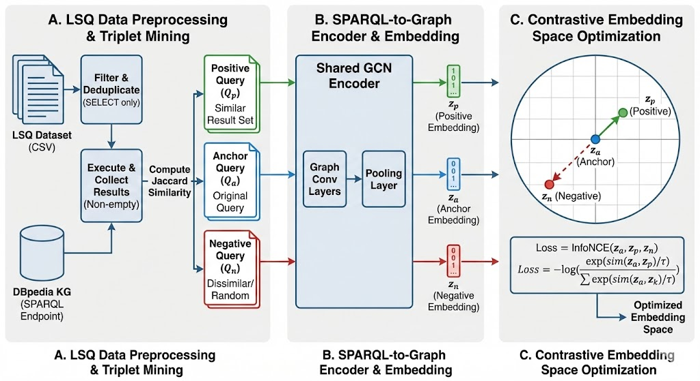

# SPARQLCE — SPARQL Query Embeddings with Contrastive Learning

[](https://opensource.org/licenses/MIT)
[](https://www.python.org/)
[](https://pytorch.org/)

SPARQLCE learns dense vector representations of SPARQL queries grounded in **result-set semantics**. Two queries are considered similar if their answer sets over a knowledge graph overlap (Jaccard similarity). The encoder combines **CodeBERT** token representations with a **GATv2** graph neural network over the SPARQL algebra graph, trained with an **in-batch InfoNCE** contrastive objective.

---

## Architecture



The pipeline proceeds in three stages:

- **A. Data Preprocessing & Triplet Mining** — Collect SPARQL queries from LSQ logs, execute against a DBpedia SPARQL endpoint, compute pairwise Jaccard similarity over result bindings, and construct (anchor, positive, negative) triplets.
- **B. SPARQL-to-Graph Encoding** — Parse each query into an algebra tree, convert to a directed graph, encode node/edge labels with CodeBERT, and apply GATv2 layers to produce a pooled embedding.
- **C. Contrastive Optimization** — Train with in-batch InfoNCE loss so that queries with overlapping result sets are geometrically close in embedding space.

---

## Project Structure

```text
SPARQL-Embeddings/
├── data/
│   ├── dbpedia_queries/
│   │   ├── 01_dbpedia_query_collection.ipynb       # Fetch & filter LSQ queries
│   │   └── 02_dbpedia_semantic_triplets.ipynb      # Build Jaccard-based triplets
│   ├── wikidata_queries/
│   │   ├── 01_wikidata_query_collection.ipynb
│   │   └── 02_wikidata_semantic_triplets.ipynb
│   └── semantic_triplets/                          # (anchor, positive, negative) JSON files
├── src/
│   ├── config.py                                   # Hyperparameters & paths
│   ├── sparql_graph_builder.py                     # SPARQL → NetworkX graph
│   ├── hybrid_encoder.py                           # HybridSPARQLEncoder (CodeBERT + GATv2)
│   ├── sparql_dataset.py                           # SPARQLTripletDataset (PyG)
│   ├── embedder.py                                 # SPARQLEmbedder inference wrapper
│   └── requirements.txt
├── training/
│   ├── 01_train_dbpedia.ipynb
│   └── 02_train_wikidata.ipynb
├── evaluation/
│   ├── 01_evaluate_dbpedia.ipynb
│   └── 02_evaluate_wikidata.ipynb
├── docs/
│   └── image.png                                   # Architecture diagram
├── STRUCTURE.md
├── LICENSE
└── README.md
```

---

## Quickstart

### 1. Install

```bash
git clone https://github.com/hzahera/SPARQL-Embeddings.git
cd SPARQL-Embeddings
pip install -r src/requirements.txt
```

### 2. Run the pipeline

| Step | Notebook | Output |
|------|----------|--------|
| 1 | `data/dbpedia_queries/01_dbpedia_query_collection.ipynb` | `data/successful_queries/successful_queries_dbpedia.json` |
| 2 | `data/dbpedia_queries/02_dbpedia_semantic_triplets.ipynb` | `data/semantic_triplets/semantic_triplets_dbpedia.json` |
| 3 | `training/01_train_dbpedia.ipynb` | `checkpoints/triplet_model_semantic-20.pt` |
| 4 | `evaluation/01_evaluate_dbpedia.ipynb` | Metric tables in `evaluation/results/` |

> Run all notebooks from the **project root** so that relative paths resolve correctly.

### 3. Encode a query

```python
from src.embedder import SPARQLEmbedder

embedder = SPARQLEmbedder("checkpoints/triplet_model_semantic-20.pt")
query = "SELECT ?person WHERE { ?person a <dbo:Scientist> . ?person <dbo:birthPlace> <dbr:Germany> }"
embedding = embedder.encode(query)  # shape: (128,)
print(embedding.shape)
```

---

## Model

**HybridSPARQLEncoder** (`src/hybrid_encoder.py`)

| Component | Details |
|-----------|----------|
| Text encoder | `microsoft/codebert-base` (768-dim) |
| Graph encoder | GATv2Conv — 2 layers, 4 heads, 256 hidden dim |
| Pooling | Global mean pool over graph nodes |
| Projection | Linear(256×4 → 128), L2-normalized |
| Loss | In-batch InfoNCE (temperature = 0.05) |
| Optimizer | Adam, lr = 1e-5, weight decay = 1e-5 |

**Baselines:** Qwen3-Embedding, MiniLM, E5, MPNet, TF-IDF (unigrams + bigrams).

---

## Evaluation

All metrics are computed over the held-out test split. SPARQL results are cached; embeddings are computed once per model.

| Metric | Description |
|--------|-------------|
| **Avg Jaccard@k** | Mean result-set Jaccard of top-k retrieved queries |
| **nDCG@k** | Normalized DCG using Jaccard as graded relevance |
| **P / R / F1@k** | Binary precision/recall/F1 (Jaccard ≥ 0.8 = relevant) |

---

## Dataset

- **Source:** [LSQ — Linked SPARQL Queries](http://lsq.aksw.org/) (DBpedia query logs)
- **Triplet thresholds:** Jaccard ≥ 0.8 → positive; Jaccard ≤ 0.1 → negative
- **Splits:** 70% train / 15% validation / 15% test (stratified by anchor)

---

## Configuration

All hyperparameters are centralised in `src/config.py`:

```python
MODEL_NAME     = "microsoft/codebert-base"
EMBEDDING_DIM  = 768    # CodeBERT output
HIDDEN_DIM     = 256    # GATv2 hidden
OUTPUT_DIM     = 128    # Final embedding
GNN_HEADS      = 4
BATCH_SIZE     = 4
LEARNING_RATE  = 1e-5
EPOCHS         = 20
TEMPERATURE   = 0.05
```

---

## Requirements

- Python 3.10+, PyTorch 2.0+, PyTorch Geometric 2.3+
- `transformers`, `rdflib`, `networkx`, `SPARQLWrapper`
- `sentence-transformers`, `scikit-learn`, `pandas`, `matplotlib`
- CUDA GPU recommended for training

See `src/requirements.txt` for pinned versions.

---

## Citation

TBD — paper under review.

---

## License

MIT — see [LICENSE](LICENSE).
