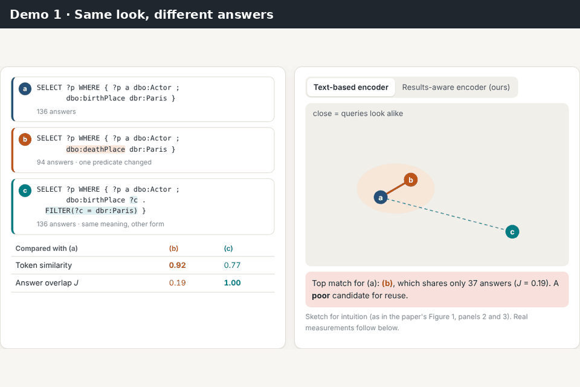
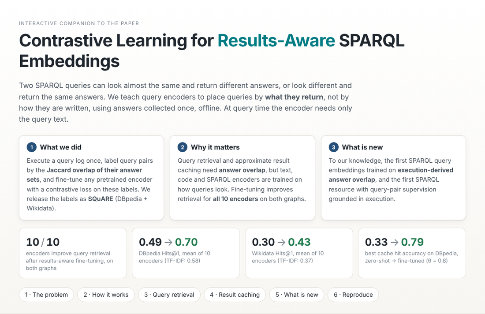
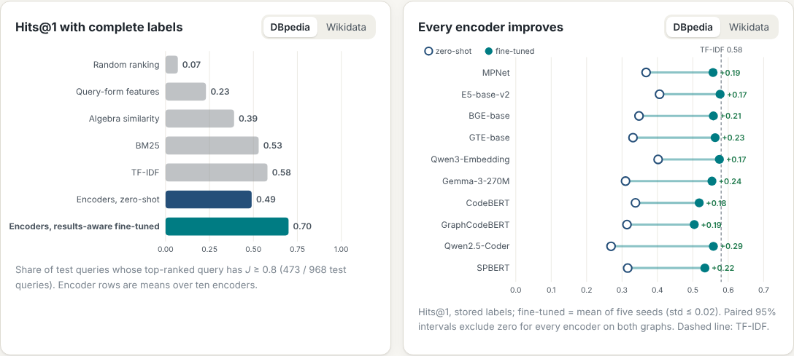
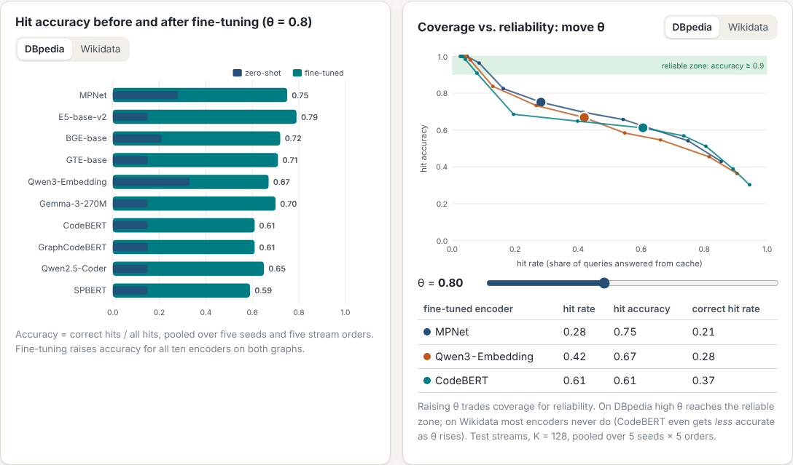

# Result-Aware Transformers for SPARQL

A model-agnostic benchmark for testing whether **execution-derived dynamic hard-negative contrastive fine-tuning** makes transformer embeddings more aware of SPARQL execution results.

The same zero-shot and fine-tuned checkpoints are evaluated on three connected experiments:

1. **Result awareness / alignment** — Spearman correlation between cosine similarity and answer-set Jaccard.
2. **Result-aware retrieval** — MRR, Hits, nDCG, Precision, Recall, and F1 at `k = 3,5,10,20`.
3. **Semantic query caching** — validation-selected cosine threshold, cache precision/recall/F1, hit rate, false-hit rate, and safe execution savings.

The repository is designed so that adding a new Hugging Face transformer requires a config/registry entry, not changes to the training or evaluation logic.

## 👉 Interactive demo (start here)

<!-- LIVE DEMO LINK: replace LIVE_DEMO_URL below with the website link of this repository
     (Anonymous GitHub: enable "GitHub Pages" when anonymizing; GitHub: Settings > Pages > branch, folder /docs). -->
### [▶ Open the live interactive demo](LIVE_DEMO_URL)

[](LIVE_DEMO_URL)

A visual tour of the paper in the browser, no installation:

- **What we did:** execute a query log once, label query pairs by the Jaccard overlap of their answers, and fine-tune any encoder contrastively on these labels (the **SQuARE** resource). Only the query text is needed at inference.
- **Why it matters:** queries that look alike often return different answers, and the reverse. Results-aware fine-tuning improves query retrieval for **all 10 encoders** on both graphs (mean Hits@1 0.49 → 0.70 on DBpedia, 0.30 → 0.43 on Wikidata, above TF-IDF) and raises cache hit accuracy on DBpedia from 0.15–0.33 (zero-shot) to 0.59–0.79 (fine-tuned).
- **What is new:** to our knowledge, the first SPARQL query embeddings trained on execution-derived answer overlap, and the first SPARQL resource with execution-grounded query-pair supervision.

<details>
<summary><b>More screenshots</b> (click to expand)</summary>

**Overview**



**Query retrieval: every encoder improves, and answer labels beat syntax labels**



**Approximate result caching: accuracy before/after fine-tuning and the threshold trade-off**



</details>

The demo is one self-contained file, [`docs/index.html`](docs/index.html), built from the sources in [`demo/`](demo/) (see [`demo/README.md`](demo/README.md)).

---

## 1. Experimental hypothesis

The central hypothesis is:

> A common dynamic hard-negative fine-tuning procedure, supervised by answer-set equivalence, systematically changes transformer embedding geometry so that cosine similarity better reflects SPARQL result similarity.

For an anchor query `q_i` and candidate query `q_j`:

- embedding similarity: `cos(E(q_i), E(q_j))`
- execution similarity: answer-set Jaccard `J(q_i,q_j)`
- positive relation: `J >= 0.8`
- negative relation: `J <= 0.1`

The tuned model should increase held-out Spearman `rho`, improve retrieval of result-equivalent queries, and improve semantic-cache reuse quality.

---

## 2. Dynamic hard-negative recipe

The default `configs/experiment.yaml` reproduces the V30-style recipe:

- fully trainable transformer
- L2-normalized embeddings
- asymmetric InfoNCE
- temperature `0.05` (`scale = 20`)
- 4 explicit negatives per anchor
- cross-anchor candidate pool
- known-positive masking
- epoch 1: random explicit negatives
- before epoch 2: mine the current model's hardest **labeled negatives**
- hard pool size: top 8
- refresh mining every 2 epochs
- explicit-negative mixture: 75% mined hard / 25% random
- 20 epochs
- AdamW, learning rate `1e-5`, weight decay `0.01`
- cosine schedule with 5% warmup
- max sequence length 512
- select the best checkpoint by validation graded `nDCG@10`
- five default seeds: `42 43 44 45 46`

Hard-negative mining only searches the training record's explicit negative candidates. Validation and test queries are never available to the miner.

---

## 3. Supported model registry

The included registry contains:

### Text embedding models

- MPNet — `sentence-transformers/all-mpnet-base-v2`
- E5-base-v2 — `intfloat/e5-base-v2`
- BGE-base — `BAAI/bge-base-en-v1.5`
- GTE-base — `thenlper/gte-base`
- Qwen3-Embedding — `Qwen/Qwen3-Embedding-0.6B`

### Code models

- CodeBERT — `microsoft/codebert-base`
- GraphCodeBERT — `microsoft/graphcodebert-base`
- Qwen2.5-Coder — `Qwen/Qwen2.5-Coder-0.5B`

### General-purpose transformer

- Gemma — `google/gemma-3-270m`

The 270M Gemma variant is used by default so full fine-tuning remains practical on a 24 GB GPU. You can replace the checkpoint in `configs/models/gemma.yaml` with a larger Gemma model while leaving the benchmark unchanged. Gemma checkpoints on Hugging Face may require accepting Google's model terms before downloading.

### SPARQL-pretrained

- SPBERT — `razent/spbert-mlm-base`

**SPBERT note:** the upstream SPBERT work uses a SPARQL-specific surface preprocessing convention. This code deliberately does not invent or silently apply an approximate rewrite. `spbert.yaml` therefore uses `input_transform: identity` by default. For a publication-faithful SPBERT baseline, register the exact upstream preprocessing function in `src/result_aware/preprocessing.py` and select it in the model config.

---

## 4. Dataset format

The clean split files are expected to use the rebuilt format:

```json
[
  {
    "anchor_query": "SELECT ...",
    "positive_queries": [
      {"query": "SELECT ...", "answer_jaccard": 1.0},
      {"query": "SELECT ...", "answer_jaccard": 0.92}
    ],
    "negative_queries": [
      {"query": "SELECT ...", "answer_jaccard": 0.04}
    ]
  }
]
```

The default paths expect the following layout if this repository sits inside your `SPARQL-Embeddings` root:

```text
SPARQL-Embeddings/
├── datasets/
│   ├── dbpedia-clean-splits/
│   │   ├── dbpedia-train-clean.json
│   │   ├── dbpedia-valid-clean.json
│   │   └── dbpedia-test-clean.json
│   └── wikidata-clean-splits/
│       ├── wikidata-train-clean.json
│       ├── wikidata-valid-clean.json
│       └── wikidata-test-clean.json
└── result-aware-transformers/
```

If your files live elsewhere, edit `configs/experiment.yaml`.

---

## 5. Installation

```bash
cd result-aware-transformers
python -m venv .venv
source .venv/bin/activate
pip install --upgrade pip
pip install -e .
```

Or inside your existing Conda environment:

```bash
conda activate sparql
cd result-aware-transformers
pip install -e .
```

For gated Hugging Face checkpoints such as Gemma, authenticate first:

```bash
huggingface-cli login
```

---

## 6. Validate the clean splits before training

```bash
python scripts/validate_data.py --dataset dbpedia
python scripts/validate_data.py --dataset wikidata
```

The validator checks:

- duplicate anchors
- missing positive/negative candidates
- positive threshold violations
- negative threshold violations
- self-candidates
- duplicate candidates within an anchor
- normalized query overlap across train/validation/test

The original clean-split generation should still remain the authoritative source for its stronger component/result-fingerprint leakage checks. This runtime validator is an additional guard before each experiment.

---

## 7. Run one model first

Start with E5 on DBpedia:

```bash
CUDA_VISIBLE_DEVICES=0 python scripts/run_experiment.py \
  --models e5-base-v2 \
  --datasets dbpedia \
  --seeds 42 43 44 45 46
```

This performs:

1. zero-shot validation evaluation
2. zero-shot test evaluation
3. zero-shot semantic-cache validation threshold selection + frozen test evaluation
4. five independent dynamic-hard-negative fine-tuning runs
5. best-checkpoint selection by validation nDCG@10
6. tuned validation/test evaluation for every seed
7. tuned semantic-cache evaluation for every seed
8. result aggregation

The run is resumable. Existing checkpoints/results are skipped unless `--force` is passed.

---

## 8. Run the complete benchmark

```bash
CUDA_VISIBLE_DEVICES=0 python scripts/run_experiment.py \
  --models all \
  --datasets dbpedia wikidata \
  --seeds 42 43 44 45 46
```

For a memory-heavy model you can apply a runtime-only batch override:

```bash
CUDA_VISIBLE_DEVICES=0 python scripts/run_experiment.py \
  --models qwen3-embedding \
  --datasets dbpedia \
  --batch-size 4 \
  --grad-accum 8
```

For the strongest controlled comparison, keep the same **micro-batch size** across models when hardware permits, because cross-anchor negatives are formed inside each micro-batch. If you must use model-specific micro-batches, record and report that difference; gradient accumulation equalizes optimizer batch size but not the number of in-batch negatives.

---

## 9. What exactly is evaluated?

### 9.1 Alignment

For every stored held-out anchor-candidate relation, the evaluator collects:

```text
cosine(E(anchor), E(candidate))
answer_jaccard(anchor, candidate)
```

and reports Spearman correlation over all stored pairs in the split.

The zero-shot value is deterministic for the checkpoint/config. Fine-tuned values are aggregated over five seeds as mean ± sample standard deviation.

### 9.2 Retrieval

For each held-out anchor, **all candidates attached to that anchor** are ranked by cosine similarity.

Binary relevance is:

```text
J >= 0.8
```

The code intentionally uses `>=`, matching clean-dataset construction.

At `k = 3,5,10,20` it reports:

- MRR@k
- Hits@k
- graded nDCG@k using the actual Jaccard value as linear gain
- Precision@k
- Recall@k
- F1@k

Metrics are macro-averaged over anchors.

Zero-shot and tuned models always rank the exact same anchor/candidate universe.

### 9.3 Semantic query cache

The included cache experiment is a **candidate-cache simulation** based on the same held-out candidate universe:

1. treat each anchor as an incoming query
2. retrieve the highest-cosine cached candidate
3. accept the semantic hit only if cosine >= threshold `tau`
4. count the reuse as correct only if the selected candidate has `J >= 0.8`

The cosine threshold is selected **only on validation**. By default the selector maximizes hit rate subject to cache precision >= 0.95. The chosen threshold is then frozen and applied to test.

Reported cache metrics include:

- precision of accepted semantic hits
- opportunity recall
- F1
- hit rate
- false-hit rate
- correct-hit rate
- raw execution savings
- safe execution savings (correct hits only)

If your paper's semantic-cache experiment later uses a temporal query stream or a different cache-population protocol, keep the model/threshold interface and replace only `cache_eval.py`'s candidate-cache simulator.

---

## 10. Result directory

```text
results/
├── raw/
│   ├── dbpedia/
│   │   ├── data_audit.json
│   │   └── e5-base-v2/
│   │       ├── experiment_manifest.json
│   │       ├── zero_shot/
│   │       │   ├── evaluation_validation.json
│   │       │   ├── evaluation_test.json
│   │       │   └── cache.json
│   │       └── tuned/
│   │           ├── seed_42/
│   │           │   ├── best_model/
│   │           │   ├── mining/
│   │           │   ├── training_history.json
│   │           │   ├── training_summary.json
│   │           │   ├── evaluation_validation.json
│   │           │   ├── evaluation_test.json
│   │           │   └── cache.json
│   │           └── ...
│   └── wikidata/
├── aggregated/
│   └── summary.json
└── tables/
```

Each mining refresh is saved as JSON with the selected hard negatives, current cosine scores, and their ground-truth Jaccards. This makes the dynamic mining process auditable.

---

## 11. Generate the paper tables automatically

After experiments finish:

```bash
python scripts/aggregate_results.py
python scripts/generate_tables.py
```

This writes:

```text
results/tables/
├── alignment.tex
├── dbpedia_ranking.tex
├── dbpedia_binary.tex
├── dbpedia_cache.tex
├── wikidata_ranking.tex
├── wikidata_binary.tex
└── wikidata_cache.tex
```

The ranking/binary tables are generated at `k = 3,5,10,20` and use the same `J >= 0.8` relevance rule as the dataset construction.

---

## 12. Add another model later

You can add one manually by creating one YAML model config plus one registry entry, or use:

```bash
python scripts/add_model.py \
  --key modernbert \
  --hf-id answerdotai/ModernBERT-base \
  --display-name ModernBERT \
  --category text \
  --architecture encoder \
  --pooling mean
```

Then run it without changing training/evaluation code:

```bash
python scripts/run_experiment.py \
  --models modernbert \
  --datasets dbpedia wikidata \
  --seeds 42 43 44 45 46
```

If a future architecture cannot be represented by `AutoModel + {mean, cls, last_token} pooling`, implement a small custom adapter with the same `forward_texts` / `encode` interface.

---

## 13. Reproducibility rules to keep for the paper

1. Never mine negatives from validation or test.
2. Never tune the semantic-cache threshold on test.
3. Use the same held-out anchor/candidate universe for zero-shot and tuned evaluation.
4. Preserve the same result-equivalence threshold across construction and evaluation (`J >= 0.8`).
5. Keep the mining/loss procedure common across model families.
6. Treat tokenizer/pooling/prefix as model-specific representation requirements, not task-specific hyperparameter search.
7. Report any model-specific batch-size or parameter-efficient-training exceptions explicitly.
8. Use all five training seeds for tuned table cells.
9. Generate publication tables directly from saved JSON outputs rather than manual transcription.

---

## 14. Tests

Run the lightweight local tests with:

```bash
pytest -q
```

They do not download transformer checkpoints. They validate the metric definitions, dataset parsing, split-overlap checks, dynamic sampling, and cache-threshold logic.
