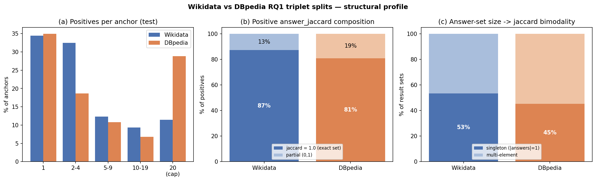

# Dataset statistics — Wikidata vs DBpedia RQ1 triplet splits

Reproducible profiling of the triplet datasets and their train/valid/test splits.
Motivated by the observation that Wikidata's positives-per-anchor and
`answer_jaccard` looked "abnormal" (jaccard appears to be only 0 or 1). The
numbers below show this is a **construction property shared by both KGs**, not a
Wikidata-specific defect.

Reproduce:

```bash
python scripts/analyze_split_stats.py        # per-split structural stats
python scripts/analyze_answerset_sizes.py    # answer-set size distribution
python scripts/plot_split_stats.py           # -> datasets/figures/split_stats.png
```



## 1. Splits are internally consistent

| KG | total | train | valid | test |
|----|------:|------:|------:|-----:|
| Wikidata | 10,735 | 8,588 | 1,073 | 1,074 |
| DBpedia  |  4,713 | 3,770 |   471 |   472 |

Every metric below is stable across train ≈ valid ≈ test (see script output), so
the split introduces no distributional drift.

## 2. `answer_jaccard` is bimodal **by construction — in both KGs**

Positives and negatives are labelled by answer-set overlap, so the values are not
free-floating:

| answer_jaccard | Wikidata (test) | DBpedia (test) |
|---|---:|---:|
| **Negatives** = exactly 0.0 | **100.0%** | **100.0%** |
| Positives = exactly 1.0 (identical answer set) | 87.2% | 80.8% |
| Positives in (0, 1) (partial overlap) | 12.8% | 19.2% |
| Positives = 0.0 | 0.0% | 0.0% |

- **Negatives are *defined* as zero-overlap** → every negative is exactly 0.0.
- **Positives are dominated by exact set-equality** → mostly exactly 1.0.

So "jaccard is either 0 or 1" is a property of the whole benchmark. DBpedia has
the same shape, only slightly softer (more partial positives: 19% vs 13%).

## 3. Why exact-1.0 dominates: singleton result sets

The bimodality is driven by **answer-set size**. When a query returns a singleton
(or two identical sets), Jaccard can only be 0 (disjoint) or 1 (equal) — partial
values require multi-element partial overlap.

| result-set size | Wikidata | DBpedia |
|---|---:|---:|
| singleton (`|answers| = 1`) | **53.3%** | 45.2% |
| ≤ 2 | 55.4% | 58.3% |
| ≤ 5 | 59.6% | 72.4% |
| median | **1** | 2 |
| mean | 16,869 | 12.1 |
| max | 6,614,463 | 2,164 |

Wikidata has *more* singleton result sets (53% vs 45%), which is exactly why its
positives collapse to jaccard = 1.0 more often (87% vs 81%). Note Wikidata's mean
is dominated by a heavy tail (a few queries return millions of rows) while the
median is 1 — the answer-set size itself is bimodal.

## 4. Positives per anchor: skewed and capped, in both

| positives/anchor | Wikidata (test) | DBpedia (test) |
|---|---:|---:|
| median | 2 | 4 |
| mean | 5.6 | 8.4 |
| % anchors with exactly 1 positive | 34.5% | 35.0% |
| % anchors at the cap (20) | 11% | 29% |

Histogram (test, % of anchors):

| bucket | 1 | 2–4 | 5–9 | 10–19 | 20 (cap) |
|---|---:|---:|---:|---:|---:|
| Wikidata | 34% | 32% | 12% | 9% | 11% |
| DBpedia  | 35% | 19% | 11% | 7% | 29% |

Both are heavily right-skewed with a hard cap at 20 positives. Contrary to first
impression, Wikidata has **fewer** positives per anchor than DBpedia — DBpedia is
the one that piles up at the cap.

## Takeaways

1. The 0/1 jaccard and the low median positives are **not bugs** — they follow
   from the labelling rule (negatives = 0 overlap, positives = high/exact overlap)
   and from the high share of singleton result sets.
2. **Wikidata does not have a pathology DBpedia lacks.** The differences are
   modest and mostly the *opposite* of the initial impression: Wikidata is more
   concentrated at jaccard = 1 and has fewer positives per anchor.
3. If the concern is that exact-set-equal positives are "too easy", the lever is
   the partial-overlap / low-lexical-similarity fraction — precisely what the
   `wikidata_testset_RQ1_balanced.json` (`cos < 0.3`) split isolates.
